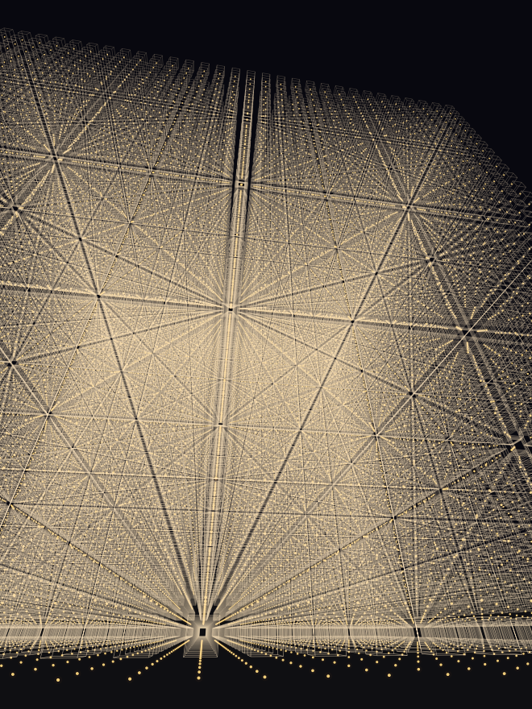
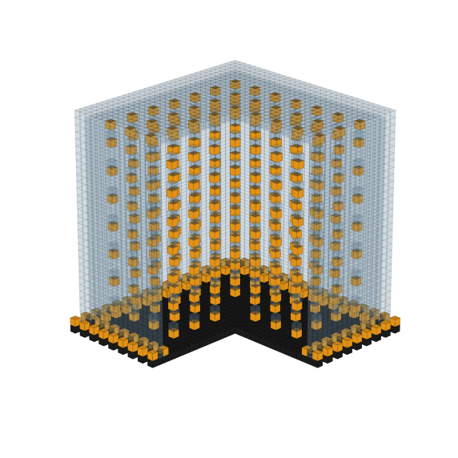
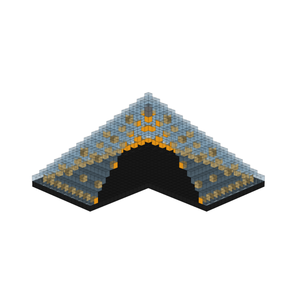

# Стеклянная решётка как в видео (датапак для Minecraft 1.18.2)

**Главное:** огромный куб, сплошь заполненный стеклянными блоками через один (стекло → пустота → стекло
по всем трём осям). Как в видео, **под каждым стеклом висит обычный фонарь**: столбики «фонарь — стекло —
фонарь — стекло...», а самый нижний ряд фонарей висит прямо над полом из чёрного бетона.

| Команда | Куб | Стекло | Фонари | Стоять не выше Y |
|---|---|---|---|---|
| `/function pyramid:lattice_small` | 64×64×64 | 32 768 | 32 768 | 256 |
| `/function pyramid:lattice_medium` | 128×128×128 | 262 144 | 262 144 | 192 |
| `/function pyramid:lattice_large` | 192×192×192 | 884 736 | 884 736 | 128 |
| `/function pyramid:lattice_huge` | 224×224×224 | 1 404 928 | 1 404 928 | 96 |

Центр куба по горизонтали будет там, где вы стоите, низ куба — на уровне ваших ног.
Через 2 секунды после команды куб появится сразу целиком. На больших размерах игра может подвиснуть на
от нескольких секунд до нескольких минут, пока считается свет от фонарей: это нормально, не закрывайте игру.
Удалить: `/function pyramid:lattice_remove_medium` (и т.д.). Стоять при этом надо там же, где строили.

Внутри можно летать: между рядами стекла есть сквозные проходы.



---

## Другие постройки в этом же датапаке

Датапак строит большой стеклянный куб (как в видео) или пирамиду с фонарями одной командой. Он сделан для сборки
**DeceasedCraft** (Minecraft **1.18.2**, Forge), но работает в любом Minecraft Java 1.18.2.
Для 1.20.1 есть отдельный архив.

## Куб (как в видео)

| Команда | Сторона | Стекло | Фонари |
|---|---|---|---|
| `/function pyramid:cube_small` | 31 | 4 561 | 169 |
| `/function pyramid:cube_medium` | 41 | 8 081 | 260 |
| `/function pyramid:cube_large` | 61 | 18 121 | 465 |
| `/function pyramid:cube_grid_small` | 31 | 4 903 | 511 |
| `/function pyramid:cube_grid_medium` | 41 | 8 809 | 988 |
| `/function pyramid:cube_grid_large` | 61 | 20 486 | 2 830 |

`cube_*` — пустая стеклянная комната-куб: фонари вдоль стен внутри и снаружи, фонари висят под потолком.
`cube_grid_*` — то же самое, но внутри ещё объёмная сетка: стеклянные блоки, под каждым висит фонарь.
Удалить: `/function pyramid:cube_remove_small` / `cube_remove_medium` / `cube_remove_large`
(стоять там же, где строили). Пол куба — на уровне ваших ног, центр — там, где вы стоите.



## Пирамида

| Размер | Команда | Основание | Высота | Стекло | Фонари |
|---|---|---|---|---|---|
| маленькая | `/function pyramid:build_small` | 31×31 | 16 | 961 | 125 |
| средняя | `/function pyramid:build_medium` | 51×51 | 26 | 2601 | 289 |
| большая | `/function pyramid:build_large` | 81×81 | 41 | 6561 | 665 |

Пол сделан из чёрного бетона. Вдоль стен на полу стоят фонари, под наклонными стенами висят
фонари, в центре под вершиной висит фонарь на цепи.



## Установка (Prism Launcher)

1. **Сначала сделайте копию мира** на всякий случай.
2. В Prism нажмите правой кнопкой на сборку DeceasedCraft → **«Папка»**.
3. Откройте `minecraft` (или `.minecraft`) → `saves` → папку вашего мира → `datapacks`.
4. Положите туда файл `build/pyramid-datapack-1.18.2.zip`. **Распаковывать не нужно.**

## Как построить (в выживании)

1. Зайдите в мир.
2. Нажмите Esc → **«Открыть для сети»** → **«Разрешить читы: ВКЛ»** → **«Открыть мир для сети»**.
   Читы включатся только до выхода из мира.
3. Встаньте на ровное место. **Центр пирамиды будет там, где вы стоите.**
4. Введите в чат:
   ```
   /reload
   /function pyramid:lattice_small
   ```
5. Чтобы убрать пирамиду, встаньте **на то же место** и введите `/function pyramid:remove_medium`
   (для других размеров: `remove_small`, `remove_large`).

⚠️ Всё, что стоит внутри области пирамиды, будет заменено.

## Пересборка
`python3 generate.py` заново создаёт архивы в `build/`.
